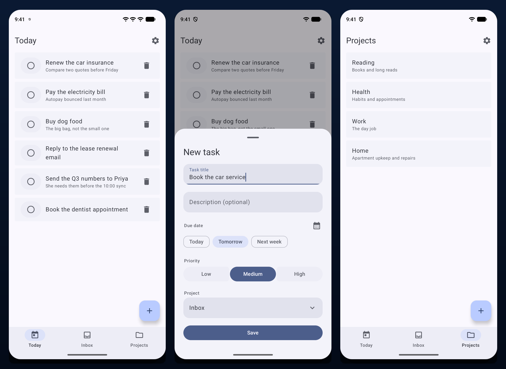
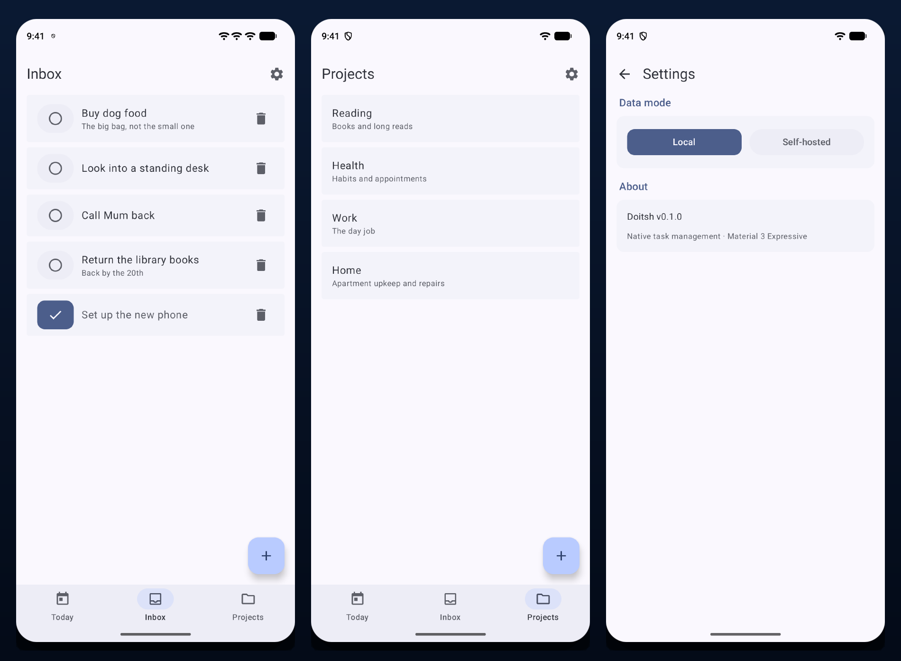
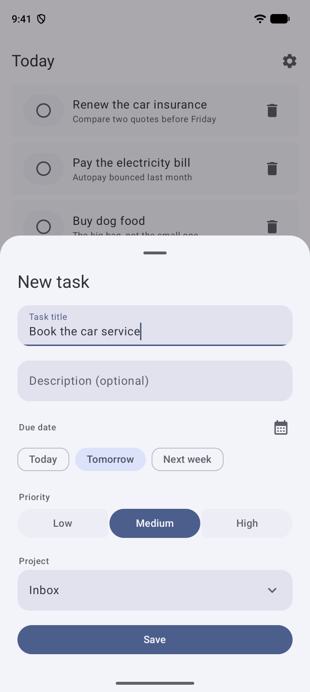
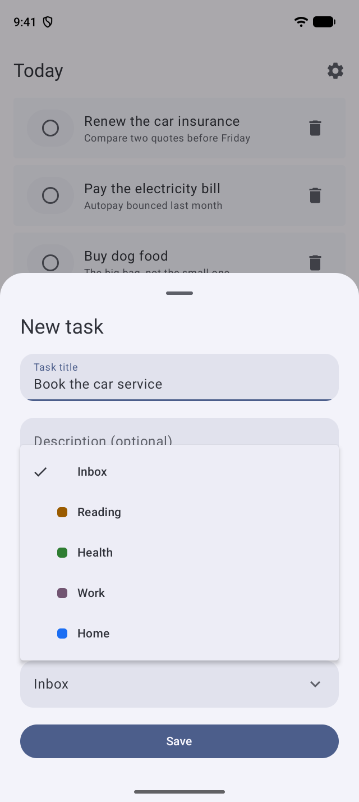
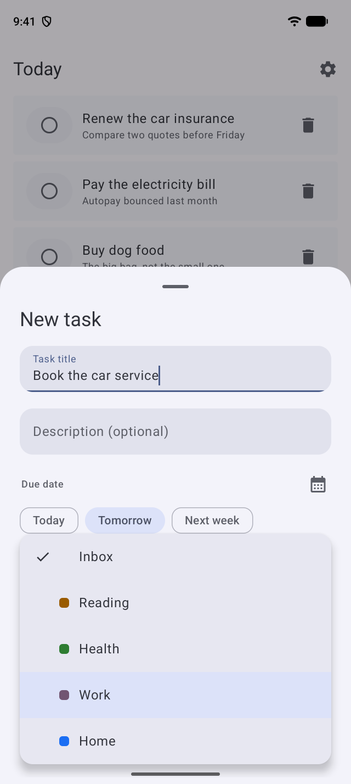
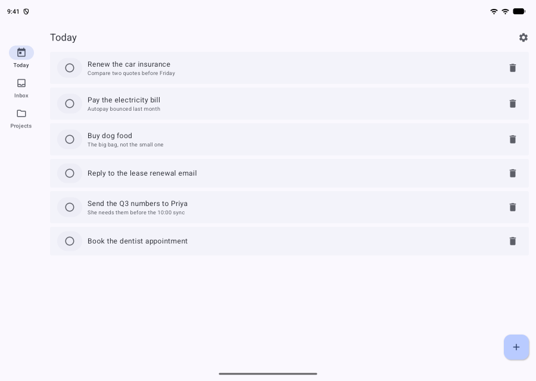
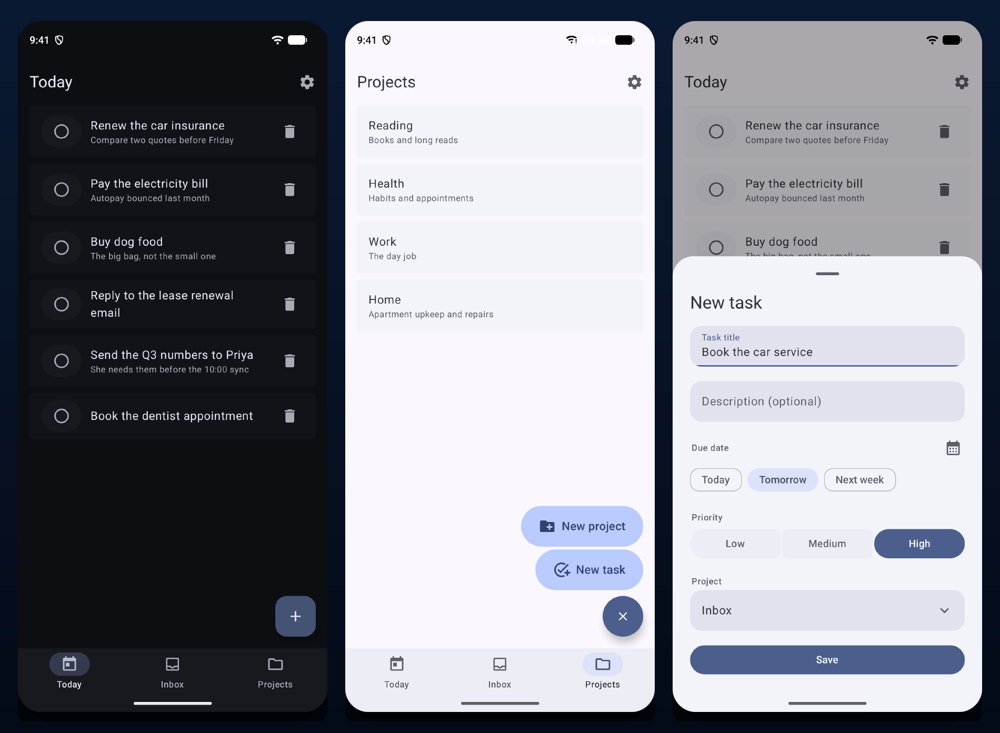

# Doitsh

**A local-first task manager for Android, built on Material 3 Expressive.**

Offline by default, self-hosted when you want it. No account, no telemetry, no cloud
you did not choose — your tasks live in Room on the device until you point the app at
your own Ktor server.

<br>



<br>

[](#getting-started)
[](gradle/libs.versions.toml)
[](gradle/libs.versions.toml)
[](gradle/libs.versions.toml)
[](gradle/libs.versions.toml)
[](LICENSE)

---

## What it is

Doitsh keeps a flat list of tasks and an optional set of projects, and shows you the
two things a task list is actually for: **what is due now** and **what has not been
filed yet**. Everything else is a detail you can add when you want it — a due date, a
priority, the project it belongs to.

The whole app is one `Activity`, one `NavDisplay`, and a Room database. There is no
login screen, because there is no server to log in to unless you bring one.

### Two data modes, one codebase

| | **Local** | **Self-hosted** |
|---|---|---|
| Storage | Room on the device | Your Ktor server |
| Setup | none — it works on first launch | a URL, in Settings |
| Network | never | over your LAN or a VPN |
| What the app does | reads and writes Room directly | reads and writes through the REST API |

Both modes implement the same `TaskRepository` / `ProjectRepository` interfaces, so the
screens do not know which one they are talking to. Switching is a setting, and the app
tells you plainly that it takes a restart.

<br>



<br>

## Features

### Today and Inbox are derived, not stored

The two list views are not database queries. Both are computed from the full task list
in [`TaskFilters.kt`](app/src/main/java/com/doitsh/app/data/repository/TaskFilters.kt),
which is the point: the local and remote repositories cannot disagree about what "Inbox"
or "Today" means, and the remote half is not a stub that quietly returns everything.

- **Today** — open tasks due today or earlier, most overdue first. A task with no due
  date never appears here; this is a deadline view.
- **Inbox** — everything not filed into a project. Completed tasks are deliberately
  **kept**: the app has no completed-tasks view, so hiding them would make a task you
  ticked by mistake impossible to untick.

Due dates are compared by calendar day, not by instant — a task due "today" is due
today at 23:59 as much as at 00:01.

### One task sheet, for creating and editing

Creating a task is a fast, contextual capture, so it gets a modal bottom sheet rather
than a dialog: the list stays visible behind it, it dismisses on a drag down, and the
form sits where the keyboard is about to appear. **Tapping a row opens the same sheet on
that task**, seeded with its values — the five fields are the same either way, so they
are one form rather than two that could drift apart.

<p align="center">
  
</p>

When creating, the title field takes focus on open; when editing it does not, because an
edit usually starts with "change the date" rather than with the title. **Save is pinned
outside the scroll region** either way — the sheet shrinks when the keyboard comes up,
and a button at the end of the content would be pushed off-screen exactly when you have
finished typing and want it.

It fills in the fields the model has always carried but no earlier screen ever set:
due date, priority, and the owning project.

### Due dates, in one tap or three

Three presets — **Today**, **Tomorrow**, **Next week** — plus a calendar for anything
else. Tapping the active preset clears it, because "I did not mean to set a date" should
not require hunting for a separate clear button. A date chosen from the calendar that
happens to land on a preset day is reported as that preset; the app does not make you
care which control produced today's date.

### Priority as a connected button group

The three priorities are one continuous container whose selected item is a solid filled
pill. There is no "None" item: un-set is the absence of a choice, so a second tap on the
checked button clears it back. That is also what keeps the row to three items on a
phone's width.

### A project picker with two speeds

| Tap | Press and hold |
|---|---|
|  |  |
| a browsable menu that lists every project, with its colour dot | a short list that appears under your finger, already holding the current choice |

The difference is not cosmetic. A tap arrives somewhere unrelated and must then travel
to a target, so it needs a menu. A held drag arrives *already on* the target and only
needs a nudge — and it draws itself in a `Popup` in its own window, so the same vertical
gesture cannot also scroll the sheet or dismiss it on the way past.

### Adaptive navigation, by the spec's own rule

<p align="center">
  
  <br>
  <em>A wide window gets <code>WideNavigationRail</code>; a phone keeps the bottom bar.</em>
</p>

Which container to use is a faithful port of the Material adaptive navigation suite's
own rule, not an ad-hoc breakpoint — so a phone in **landscape** keeps the bottom bar
(it is wide but short, the `ShortNavigationBarMedium` case) and the icons simply move
beside their labels.

### Material 3 Expressive throughout

`DoitshTheme` passes `MotionScheme.expressive()` and the eight-role Expressive shape
scale to the five-argument `MaterialTheme`, and the feature code uses the Expressive
component set: `FloatingActionButtonMenu`, `ShortNavigationBar`, `WideNavigationRail`,
`ToggleButton`, `LoadingIndicator`, `ListItem`, `SwipeToDismissBox`, `ButtonGroup`.

<p align="center">
  
</p>

<br>

## Getting started

### Prerequisites

- **Android Studio** — recent enough to support AGP 9
- **JDK 17 or later** (JDK 21 tested)
- Gradle comes from the wrapper; do not install it separately

### Run the app

Open the project root in Android Studio, let it sync, and run the `app` module on an
emulator or device. **min API 34 (Android 14).**

From the command line:

```bash
./gradlew :app:installDebug
```

There is no configuration step. The app starts in Local mode with an empty database and
works immediately.

### Build a release APK

```bash
./gradlew :app:assembleRelease
```

The build is signed when it can find a keystore and its passwords, and left unsigned
otherwise — a fresh clone still builds, producing `app-release-unsigned.apk`. To sign,
set these Gradle properties (or `DOITSH_STORE_PASSWORD` / `DOITSH_KEY_PASSWORD` in the
environment, or put them in a gitignored `doitsh-release.properties` at the repo root):

| Property | Default |
|---|---|
| `doitsh.storeFile` | `~/.android/doitsh-release.jks` |
| `doitsh.storePassword` | — (required to sign) |
| `doitsh.keyAlias` | `doitsh` |
| `doitsh.keyPassword` | — (required to sign) |

> Keep the keystore and its passwords safe. An installed APK can only be upgraded by a
> build signed with the same key; losing it means existing users must uninstall first.

### Run the server

```bash
./gradlew :server:run
```

The server starts on `http://0.0.0.0:8080`. Point the app at it from **Settings →
Data mode → Self-hosted**, then restart.

> **Note:** the `server/` Kotlin sources **do not currently compile.** See
> [Known issues](#known-issues). `:app` is unaffected and builds, lints and assembles
> cleanly.

See [SETUP.md](SETUP.md) for the full toolchain setup (JDK, Android SDK, environment
variables).

<br>

## Architecture

```
Doitsh/
├── gradle/
│   └── libs.versions.toml    # Version catalog — the single source of truth for versions
├── app/                      # Android client (Jetpack Compose)
│   └── src/main/java/com/doitsh/app/
│       ├── data/             # Room entities, DAOs, API client, repositories
│       │   └── repository/   #   ...including TaskFilters, where Inbox/Today are derived
│       ├── domain/           # Task and Project models, repository interfaces
│       ├── di/               # Hilt modules
│       └── ui/               # Compose screens, theme and components
│           ├── components/   #   TaskList, TaskEditorSheet, navigation bar/rail
│           └── screens/      #   Today, Inbox, Projects, Settings + their ViewModels
├── server/                   # Ktor REST API server
│   └── src/main/kotlin/com/doitsh/server/
│       ├── Application.kt    # Entry point
│       ├── Routing.kt        # API endpoints
│       ├── Tables.kt         # Exposed ORM table definitions
│       ├── Security.kt       # JWT authentication
│       ├── Database.kt       # Connection and pooling
│       ├── Cors.kt           # CORS configuration
│       └── Serialization.kt  # JSON content negotiation and error handling
└── docs/                     # Screenshots used by this README
```

The app's navigation is a **Navigation 3** back stack — `Today`, `Inbox` and `Projects`
sit in the bar, and `Settings` is pushed on top of them. Because it is pushed rather
than selected, the bar and rail hide while it is open and its top bar carries a back
arrow instead.

### A note on the transitions

`NavDisplay` renders the outgoing and incoming scenes *simultaneously* and slides them
past each other, so every destination needs an opaque background of its own. Without
one, two screens composite straight onto each other and their text superimposes — which
looks like a cross-fade, reads as a scale-down mid-drag, and was originally
misdiagnosed as a predictive-back bug. Each entry is therefore wrapped in a
`SceneSurface` that paints the theme's `background`. See
[`DoitshApp.kt`](app/src/main/java/com/doitsh/app/ui/DoitshApp.kt) for the full account.

<br>

## Tech stack

Every dependency version lives in one place:
[`gradle/libs.versions.toml`](gradle/libs.versions.toml). Both modules read versions
from it rather than inlining strings.

### Build toolchain

| | Version | Notes |
|---|---|---|
| Gradle | 9.6.0 | via the wrapper |
| AGP | 9.4.1 | has **built-in Kotlin** — see below |
| Kotlin | 2.4.21 | requested explicitly; AGP 9.4.1 bundles 2.2.10 and Gradle picks the higher |
| KSP | 2.3.12 | |
| JDK | 17+ | 21 tested |

> AGP 9 has *built-in Kotlin*, so `org.jetbrains.kotlin.android` is deliberately **not**
> applied — declaring it fails the build. Kotlin options live in a top-level
> `kotlin { compilerOptions { } }` block, not `android.kotlinOptions {}`.

### Android client

| Concern | Choice |
|---|---|
| UI | Jetpack Compose, BOM **2026.09.00** |
| Design system | **Material 3 Expressive** — `material3` pinned to `1.5.0-beta01` |
| Navigation | **Navigation 3** (`androidx.navigation3` 1.2.0) with a real back stack |
| Local storage | **Room** 2.8.5 with type converters |
| DI | **Hilt** 2.60.1 |
| Networking | **Ktor client** 3.6.0 + kotlinx.serialization |
| Async | **Coroutines** 1.11.0 + Flow |
| Adaptive layout | **Material 3 Adaptive** 1.3.0 |

`material3` is pinned explicitly to `1.5.0-beta01` because the Compose BOM's 1.4.0 lacks
the Expressive FAB-menu APIs the app uses; an explicit version wins over the BOM.

Also on the classpath, added but not yet adopted by feature code: DataStore 1.2.1,
WorkManager 2.12.0, Paging 3.5.3, Coil 3.6.3, ProfileInstaller 1.4.1, OkHttp 5.5.0.

> **`compileSdk` is 37, not 36.** Every library above ships AAR metadata declaring
> `minCompileSdk=37`, and AGP 9 fails the build outright on a mismatch. `targetSdk`
> stays at 36: compiling against newer APIs and opting in to new runtime behaviour are
> separate choices.

### Server

| Concern | Choice |
|---|---|
| Framework | Ktor (Netty) 2.3.12 |
| ORM | Exposed 0.54.0 |
| Database | SQLite (default) or PostgreSQL |
| Auth | JWT + BCrypt |
| Pooling | HikariCP |

The server's runtime dependency versions are intentionally unchanged from the initial
commit; it shares only the Kotlin 2.4.21 compiler with the app.

<br>

## API endpoints

| Method | Path | Auth | Description |
|---|---|---|---|
| `GET` | `/api/health` | No | Health check |
| `POST` | `/api/auth/register` | No | Register a new user |
| `POST` | `/api/auth/login` | No | Log in, returns a JWT |
| `GET` | `/api/tasks` | JWT | List the user's tasks |
| `POST` | `/api/tasks` | JWT | Create a task |
| `DELETE` | `/api/tasks/{id}` | JWT | Delete a task |
| `GET` | `/api/projects` | JWT | List the user's projects |
| `POST` | `/api/projects` | JWT | Create a project |

### Data model

**Task** — UUID id, title, optional description, completion flag, priority
(None / Low / Medium / High), optional due date, optional project, created/updated
timestamps.

**Project** — UUID id, name, optional description, optional colour, created/updated
timestamps.

<br>

## Known issues

**The `server/` module does not compile.** These are pre-existing bugs, not toolchain
fallout — `server/src` is untouched since the initial commit. Three distinct problems:

1. `Tables.kt:4` imports `org.jetbrains.exposed.java.time.datetime`. That package does
   not exist; in Exposed 0.54.0 the classes live in `org.jetbrains.exposed.sql.javatime`.
2. `Routing.kt` uses `FieldSet.select { }`, which Exposed 0.54.0 marks
   `@DeprecationLevel.ERROR` (the SELECT DSL was redesigned). This is a hard compile
   error, not a warning. The replacement is `selectAll().where { }`.
3. `Routing.kt` references `JWTPrincipal` and `payload` without importing them —
   `io.ktor.server.auth.*` does not cover the `io.ktor.server.auth.jwt` subpackage.

`:app` is unaffected and builds, lints and assembles cleanly.

<br>

## License

[MIT](LICENSE) © 2026 CakewthinSUm
